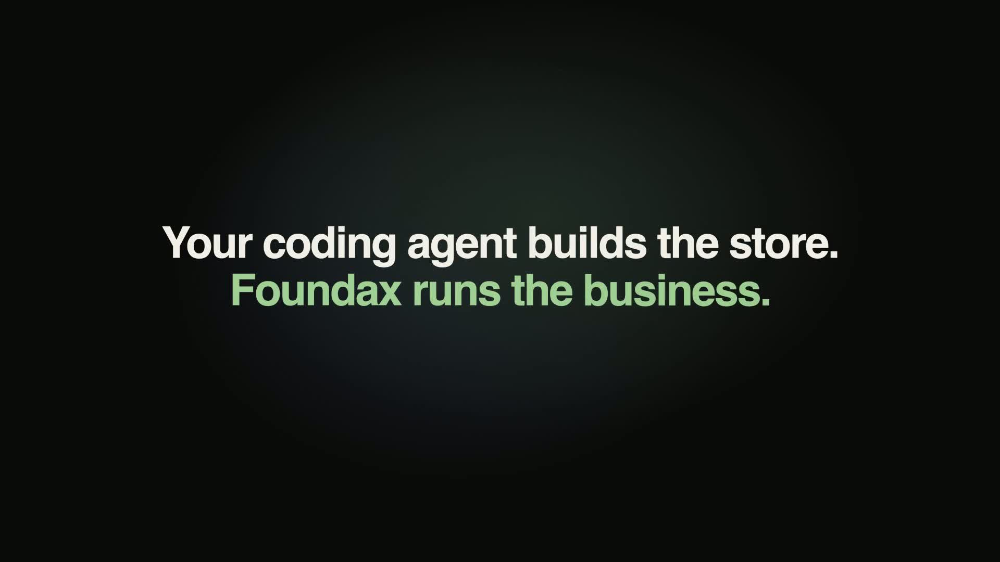
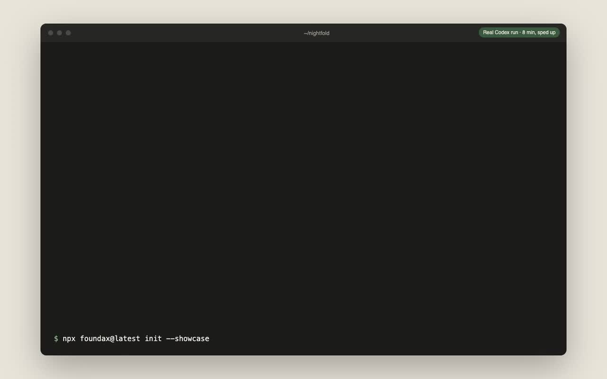
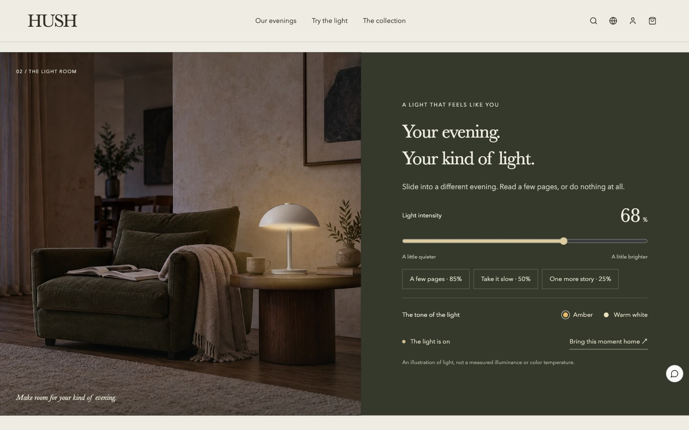
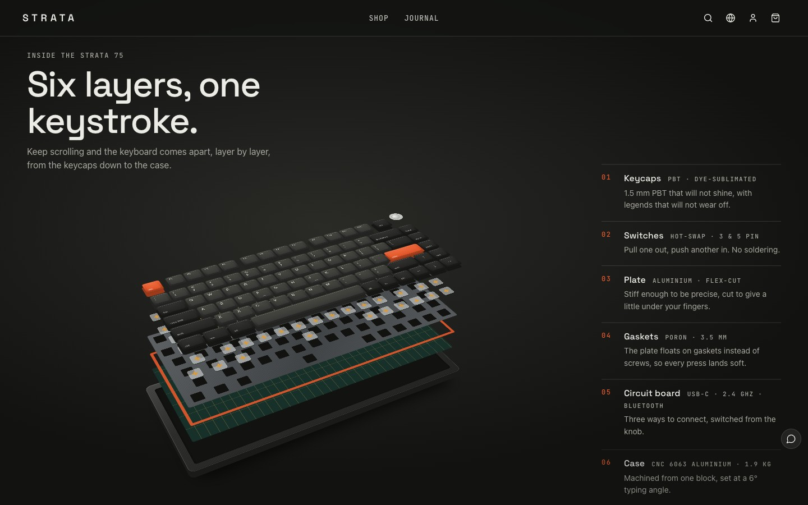

# Agent Store Starter

Let Claude Code or Codex build a complete online store on your machine: pages, products, shipping, returns,
promotions and legal pages. Preview it locally with a working cart and simulated checkout. No account required.

[简体中文](README.zh-CN.md)

[Install the skill on skills.sh](https://skills.sh/foundax/agent-store-starter/build-store)

[](https://media.novariseintl.com/official/open-source/agent-store-starter/20261107-web/demo.mp4)

[Watch the 87-second walkthrough](https://media.novariseintl.com/official/open-source/agent-store-starter/20261107-web/demo.mp4)
· [Vertical version](https://media.novariseintl.com/official/open-source/agent-store-starter/20261107-web/demo-vertical.mp4)

From a reference design to a working store: build locally, import into Foundax, edit in the visual editor,
review launch readiness and try the storefront checkout. Nightfold is a fictional demo store;
the recorded payment flow uses a test environment. The opening agent sequence is recreated from the session log.

### The original build

[](docs/build-demo.mp4)

A real Codex run, about 8 minutes, sped up: it built Nightfold, a fictional linen store, from the HUSH reference
and three product photos. [Watch the build recording](docs/build-demo.mp4).

## Start

Paste this prompt into your coding agent in an empty folder:

```text
Build a complete online store inspired by HUSH. Run the command below in an empty folder, then read AGENTS.md.
Ask me for the site name, market, currency, languages and business facts. Complete the site, business data,
local preview and checks. Learn from the reference design and adapt it to my brand.

npx foundax@latest init --showcase hush
```

Swap `hush` for `strata` to start from the keyboard store instead. You can also run the command yourself and open
the folder it creates in your agent.

## Two reference stores

| **[HUSH](https://foundax.com/showcase/hush)** — a lighting store | **[STRATA](https://foundax.com/showcase/strata)** — a mechanical keyboard store |
| --- | --- |
|  |  |
| A photographed lamp with authored light layers. Visitors switch it on, change intensity and tone; the photo itself is never swapped. | A CSS 3D keyboard model, built without images, runs through the site. Scrolling separates it into six layers; visitors change colorways and type on their own keyboard to hear the selected switch, synthesized in the browser. |

The agent reads the reference's source and its `TEMPLATE.md`, learns the layout, motion and interaction, then
redesigns for your products and brand. It does not copy the reference's wording or images.

## What the agent works with

```text
your-store/
├── AGENTS.md              the workflow your agent follows
├── site-package.json      products, shipping, returns, forms, notifications, promotions, legal pages
├── source/                the storefront: React + TypeScript
├── media/                 images, 3D models and audio you supply
└── .foundax/              storefront SDK docs, the reference case and the package JSON Schema
```

The agent uses two commands while it works:

- `npx foundax@latest check` validates the business data and compiles the source with the pinned toolchain.
  The first run downloads and caches it.
- `npx foundax@latest preview` serves the store at `http://127.0.0.1:4545` and refreshes when files change.
  Product pages, cart and checkout run against your `site-package.json`; payment and delivery are simulated.

## Going live

The preview stays on your machine: no real payments, orders or hosting. For direct agent import, sign in at
[foundax.com](https://foundax.com), open a reference's prompt dialog, choose a workspace and authorize the agent.
If you started with an authorized prompt, the CLI already saved its authorization. For an existing local build,
use the authorized prompt's origin and code to connect without replacing your files:

```sh
npx foundax@latest connect --origin https://foundax.com --code=YOUR_AUTHORIZATION
npx foundax@latest import --check
npx foundax@latest import
```

Server diagnostics go straight to your agent so it can repair and retry without manual uploads. After a timeout,
run `npx foundax@latest status` before retrying. The CLI synchronizes the local base revision after a committed import.
If the merchant has edited the project meanwhile, pull its current version into a new folder and merge your changes;
never change `baseRevisionId` to bypass a version conflict.
Successful imports return `editorUrl`; recovered imports expose it under `result.editorUrl` in the status response.
An agent with Computer Use or a browser tool can open that address in your signed-in browser and show the site in
the editor. Otherwise, follow the returned link yourself.
An authorization is scoped to one project, lasts 7 days and can be revoked from Settings → Security → Agent
authorizations or the prompt dialog. The CLI keeps it in `.foundax/authorization.json`, excluded from Git and packages.

Import applies real business data, including on an existing store. Review the resulting site in Foundax, configure
payments and your domain, complete launch readiness and publish separately. Hosting requires publication entitlement
and available published-site quota. Unsubscribed accounts have 200 MB of shared storage for media and retained snapshots.

Manual import is also available: run `npx foundax@latest pack` and upload the zip from the Foundax site list.

## Install as an agent skill

Install `build-store` into the project where you use Claude Code or Codex:

```bash
npx skills add foundax/agent-store-starter --skill build-store
```

Choose Claude Code or Codex when prompted. Add `--global` if you want the skill available across projects.
Then ask your agent to "build an online store inspired by HUSH". It will guide you through the reference,
business facts, build, checks and local preview.

[View on skills.sh](https://skills.sh/foundax/agent-store-starter/build-store).
You can also install it manually for Claude Code by copying [`skills/build-store`](skills/build-store)
into `~/.claude/skills/`.

## Requirements

Node.js 20 or later on macOS or Linux (arm64 or x64). On Windows, use WSL.

## What is open source here

This repository's prompts, skill and documentation are MIT licensed. The `foundax` CLI, its compiler kit and the
storefront SDK are free to use for building and previewing stores, but they are not open source; see the
license shipped with the CLI.

The demo recordings and their soundtrack have separate terms; see [video credits](docs/video-credits.md).

## Share what you built

Open an issue with a screenshot or recording, the reference you started from, and the agent and model you used.
Tell us where the agent got stuck as well: that helps us improve `AGENTS.md` and the SDK docs.

## Related

- [Agent-Native Business Environments](https://github.com/foundax/agent-native-business-environments):
  how a business system can become an environment an agent can explore and verify.
- [Agent Editable UI](https://github.com/foundax/agent-editable-ui): keeping agent-written pages visually editable.

