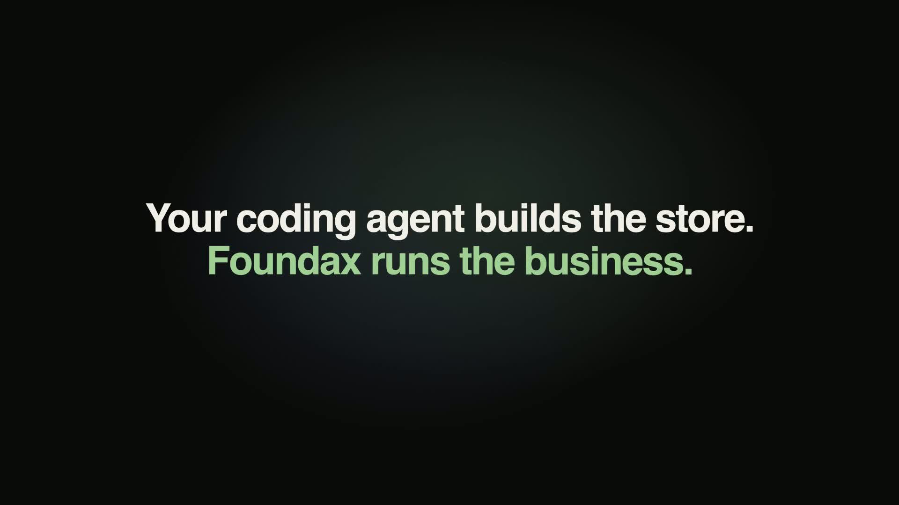
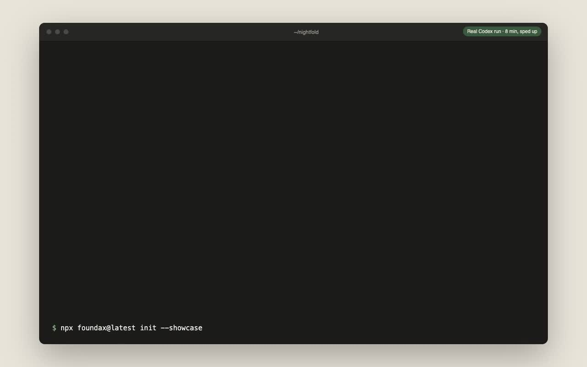
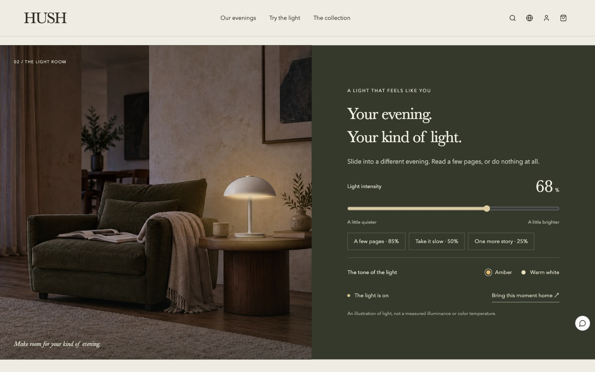
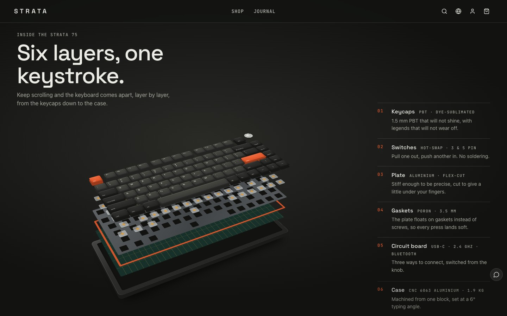

# Agent Store Starter

让 Claude Code 或 Codex 在你的电脑上做出一个完整的网店：页面、商品、运费、退货、促销和法律页面。
在本地预览，购物车和结账流程可以直接体验（支付与配送为模拟）。不需要注册账号。

[English](README.md)

[](https://media.novariseintl.com/official/open-source/agent-store-starter/20261107-web/demo.mp4)

[观看 87 秒完整演示](https://media.novariseintl.com/official/open-source/agent-store-starter/20261107-web/demo.mp4)
· [竖版视频](https://media.novariseintl.com/official/open-source/agent-store-starter/20261107-web/demo-vertical.mp4)

从参考设计到可运行的店铺：在本地搭建、导入 Foundax、在可视化编辑器中修改、检查上线准备情况，再体验店铺结账。
Nightfold 是虚构的演示店铺，视频中的支付流程使用测试环境。开头的 agent 操作画面根据真实会话日志重现。

### 原始搭建过程

[](docs/build-demo.mp4)

一次真实的 Codex 运行（约 8 分钟，已加速）：它参考 HUSH 和三张商品照片，做出了虚构的亚麻床品店 Nightfold。
[查看原始搭建录屏](docs/build-demo.mp4)。

## 开始

在一个空文件夹里，把下面这段提示词发给你的 coding agent：

```text
参考 HUSH 做一个完整的网店。先在空文件夹里运行下面的命令，然后阅读 AGENTS.md。
向我询问站点名称、市场、币种、语言和业务信息。完成站点、业务数据、本地预览和检查。
学习参考案例的设计，并按我的品牌重新设计。

npx foundax@latest init --showcase hush
```

把 `hush` 换成 `strata`，就从键盘店开始。也可以自己运行命令，再让 agent 打开生成的文件夹。

## 两个参考案例

| **[HUSH 暮间](https://foundax.com/showcase/hush)**：灯具店 | **[STRATA 层岩](https://foundax.com/showcase/strata)**：机械键盘店 |
| --- | --- |
|  |  |
| 一张灯具实拍照片，叠加手工绘制的光影层。访客可以开关灯、调亮度和色温，照片本身始终不替换。 | 一个用 CSS 3D 写成、不用图片的键盘模型贯穿全站。滚动时剖开成六层；访客可以切换配色，用自己的键盘打字，听到所选轴体的声音（浏览器实时合成）。 |

agent 会阅读参考案例的源码和 `TEMPLATE.md`，学习布局、动效和交互，再按你的商品和品牌重新设计，
不会照搬案例的文案和图片。

## agent 的工作目录

```text
your-store/
├── AGENTS.md              agent 遵循的工作流程
├── site-package.json      商品、运费、退货、表单、通知、促销、法律页面
├── source/                店铺前端：React + TypeScript
├── media/                 你提供的图片、3D 模型和音频
└── .foundax/              店铺 SDK 文档、参考案例和数据包的 JSON Schema
```

agent 工作时会用到两个命令：

- `npx foundax@latest check`：校验业务数据，并用固定版本的工具链编译源码。第一次运行会下载并缓存工具链。
- `npx foundax@latest preview`：在 `http://127.0.0.1:4545` 启动店铺，文件变化后自动刷新。
  商品页、购物车和结账都读取你的 `site-package.json`；支付和配送为模拟。

## 正式上线

预览只在你的电脑上运行，没有真实支付、订单和托管。要让 agent 直接导入，请登录
[foundax.com](https://foundax.com)，打开参考案例的提示词弹窗，选择工作区并授权。
使用已授权提示词初始化时，CLI 会自动保存授权；已有本地项目可以使用提示词里的来源地址与授权码连接，保留已制作的文件：

```sh
npx foundax@latest connect --origin https://foundax.com --code=你的授权码
npx foundax@latest import --check
npx foundax@latest import
```

服务端诊断直接返回 agent，便于修复并重试，无需手动来回上传。请求超时后先运行
`npx foundax@latest status` 查询结果；导入提交后，CLI 会同步本地基础版本。
如果商家同时修改了网站，先把最新版本拉到新目录，再合并自己的修改；不要改动 `baseRevisionId` 绕过版本冲突。
导入成功会返回 `editorUrl`，通过状态查询恢复的结果位于 `result.editorUrl`。
有 Computer Use 或浏览器工具的 agent 可以直接在你已登录的浏览器中打开该地址，展示导入后的编辑器；也可自行打开返回的链接。
授权仅限目标项目，有效期为 7 天，可在「设置 → 安全 → Agent 授权」或提示词弹窗中撤销。
CLI 将授权保存在 `.foundax/authorization.json`，排除 Git 和站点包。

导入会让商品、政策、促销等真实业务数据生效。网站发布仍需单独操作：审阅结果、配置收款和域名、
完成上线检查后发布。托管需要发布权益及可用的网站数量额度，未订阅账户有 200 MB 共享存储，包含媒体和保留的快照。

也可运行 `npx foundax@latest pack`，在 Foundax 站点列表手动导入 zip。
之后由 Foundax 负责收款、订单和托管，
你可以继续用可视化编辑器或 agent 修改店铺。

## 作为 Claude Code skill 使用

把 [`skills/build-store`](skills/build-store) 复制到 `~/.claude/skills/`。之后对 Claude Code 说“参考 HUSH 做一个网店”，
它会从正确的命令开始。

## 环境要求

Node.js 20 或更高版本，macOS 或 Linux（arm64 或 x64）。Windows 请使用 WSL。

## 哪些是开源的

本仓库的提示词、skill 和文档采用 MIT 许可。`foundax` CLI、编译工具链和店铺 SDK 可以免费用于搭建和预览店铺，
但不是开源软件，具体见 CLI 附带的许可证。

演示视频与配乐采用单独的授权条款，见[视频素材说明](docs/video-credits.md)。

## 分享你的作品

提一个 issue，附上截图或录屏、你选的参考案例，以及使用的 agent 和模型。
也欢迎说说 agent 卡在了哪里，这能帮我们改进 `AGENTS.md` 和 SDK 文档。

## 相关项目

- [Agent-Native Business Environments](https://github.com/foundax/agent-native-business-environments)：
  如何把业务系统变成 agent 可以探索和验证的环境。
- [Agent Editable UI](https://github.com/foundax/agent-editable-ui)：让 agent 写出的页面保持可视化可编辑。

